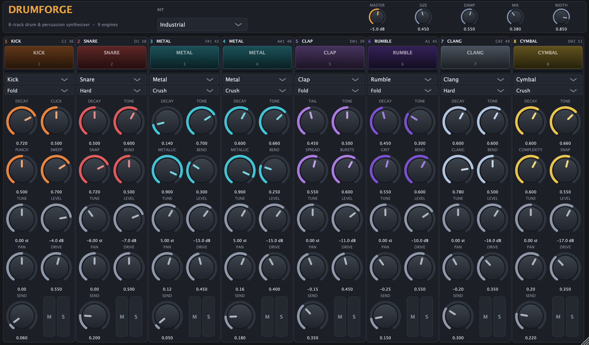

# DrumForge

An 8-track drum and percussion **VST3 instrument** built with [JUCE](https://juce.com),
tuned for industrial techno: inharmonic tunings, wavefolding and bit-crushing, sub drones
and atonal metal, alongside the clean kit it started as.

Every one of the eight tracks can load any of **nine synthesis engines**. Tracks are
triggered over MIDI using the General MIDI drum map, each track has its own drive, pan,
level and reverb send, and there are no samples anywhere in the plugin.



---

## The nine engines

Each engine is a distinct synthesis technique, not a preset of the others.

| # | Engine | Technique | Typical use |
|---|--------|-----------|-------------|
| 1 | **Kick** | Pitch-swept sine + filtered noise beater click | Kicks, 808 bass drums |
| 2 | **Snare** | Three decaying shell modes + band-limited noise wires | Snares, rimshots |
| 3 | **Membrane** | Six modal partials (harmonic ⟷ circular-membrane ratios) | Toms, congas, woodblocks |
| 4 | **Metal** | Six band-limited squares at inharmonic ratios, heavily filtered | Closed/open hats, shakers |
| 5 | **Clap** | Band-passed noise gated by a retriggering staircase envelope | Claps, snaps |
| 6 | **Cymbal** | Four ring-modulated oscillator pairs + stick-attack burst | Crashes, rides |
| 7 | **FM Perc** | Two-operator phase modulation with a decaying index | Cowbells, claves, bells |
| 8 | **Clang** | Inharmonic FM ring-modulated against a third oscillator | Atonal struck metal, industrial percussion |
| 9 | **Rumble** | Two detuned subs + a low-passed noise bed, up to 12 s | Kick tails, sub drones, tension beds |

**Clang** is the dissonance engine. Its modulator and ring ratios move between
√2, π, e and the golden ratio — never whole numbers — so its partials cannot line up with
the fundamental however you tune it. The `Clang` knob slides those ratios further from
consonance and raises the FM index, taking it from a struck bell to tearing sheet metal.

**Rumble** is the weight. Two sub oscillators a fraction of a percent apart beat slowly
against each other, which is what gives industrial kick tails their uneasy movement.
Decay reaches twelve seconds, so it doubles as a sustained bed. Push it through `Fold`
drive and it becomes the wall of sound under the kit rather than a separate instrument.

Every engine exposes the same four macro knobs, but each one **means something specific to
that engine** — the UI relabels them live:

| Engine | Decay | Tone | Character | Sweep |
|--------|-------|------|-----------|-------|
| Kick | body decay | beater click | punch (sweep speed) | sweep depth |
| Snare | body decay | noise colour | snap | shell bend |
| Membrane | decay | bright | material (tonal ⟷ inharmonic) | bend |
| Metal | decay | filter | metallic ⟷ noise | bend |
| Clap | tail | tone | spread | burst count |
| Cymbal | decay | filter | complexity | snap |
| FM Perc | decay | tone | ratio | index |
| Clang | decay | filter | inharmonicity + FM index | bend |
| Rumble | decay | noise-bed filter | grit (noise + detune) | bend |

---

## Aggression: five distortion curves

Every track has a **Drive** amount and a **distortion curve** that shapes it. This is the
main reason the kit can go from clean to hostile, and the curves are level-compensated, so
turning Drive up changes the character rather than simply the loudness (measured spread
across all five at full Drive: 0.8–1.1 dB).

| Curve | What it does |
|-------|--------------|
| **Soft** | Symmetric `tanh`. Warm, the default, barely there until pushed |
| **Hard** | Hard clip. Crunchier odd harmonics, a blunt edge |
| **Fold** | Wavefolder. Harmonics shift with level, so it sounds metallic and unstable |
| **Fuzz** | Asymmetric `tanh`. Strong even harmonics, thick and dirty |
| **Crush** | Bit reduction. Digital, aliased, deliberately cheap-sounding |

Drive at 0 is a true bypass whatever curve is selected.

---

## Dynamics: velocity modulation

Every continuous per-track parameter — the four macros plus `Tune`, `Level`, `Drive`, `Pan`
and `Send` — can be swept by velocity. Each gets its own bipolar **depth**, so one knob can
go from barely responsive to a full sweep in either direction.

The curve is anchored at **velocity 100**, which is what most keyboards and pads send by
default:

| Velocity | Effect |
|---|---|
| 127 | the full depth above the dialled value |
| **100** | the knob exactly as dialled, whatever the depth |
| 0 | the full depth below it |

Depth at 0 means velocity does not affect that parameter at all — bit for bit — so a track
is completely flat until you ask for dynamics.

Modulation is applied in *normalised* parameter space, so a depth of 0.1 means a tenth of
the knob's travel whether that knob is in dB, semitones or a 0..1 macro. It is latched at
note-on, so a ringing hit keeps the character it was struck with while other tracks move on.

This replaced four hard-coded velocity responses that used to live inside the engines: a
fixed loudness curve on all nine, plus velocity→brightness on Membrane and velocity→index on
Clang and FM Perc. Those existed only on the engines where someone had thought to add them.
Now all nine respond the same way, and you decide how much.

Depths are deliberately **not** automation parameters. Automating a knob and automating
velocity already spans the space — depth is only the slope between them, which is exactly
the thing that should stay static. They are still saved with your session.

---

## Factory kits

The kit selector in the header loads a complete setup — engines, curves, tunings, levels,
pans and sends — in one go. Every track stays editable afterwards.

| Kit | Character |
|-----|-----------|
| **Industrial** (default) | Wavefolded kick, snare tuned a tritone from it, bit-crushed hats, Rumble on the tom slot and Clang on the crash slot. ~3.5 dB hotter RMS than Studio |
| **Warehouse** | Hard-clipped kick and snare, fuzzed tom, FM Perc on the ride slot. Tough but still musical |
| **Studio** | The original clean kit, so nothing was lost in the twist |

A kit also sets each track's **level depth**, because velocity dynamics are part of a kit's
voicing — a machine-style kit and an acoustic one respond very differently. The depths on
the tone and envelope knobs are the player's expression, so loading a kit leaves those alone.

---

## Track layout and MIDI

The default kit follows the General MIDI percussion map:

| Track | Primary note | Default engine (Industrial) | GM instrument |
|-------|--------------|-----------------------------|---------------|
| 1 | 36 (C1) | Kick — Fold | Bass drum |
| 2 | 38 (D1) | Snare — Hard, tuned −6 st | Acoustic snare |
| 3 | 42 (F#1) | Metal — Crush | Closed hi-hat |
| 4 | 46 (A#1) | Metal — Crush | Open hi-hat |
| 5 | 39 (D#1) | Clap — Fold | Hand clap |
| 6 | 45 (A1) | Rumble — Fold | Low tom |
| 7 | 49 (C#2) | Clang — Hard | Crash cymbal |
| 8 | 51 (D#2) | Cymbal — Crush | Ride cymbal |

Common aliases fold onto the same tracks (35 → kick, 40 → snare, 44 → closed hat,
41/43/47/48/50 → toms, 52/55/57 → cymbals, 53/59 → ride), so GM drum files play back
correctly. Unmapped notes are ignored.

**The closed and pedal hi-hats choke the open hi-hat**, exactly as in General MIDI.

Note that the Industrial kit puts a sub drone on the tom notes and an atonal clang on the
crash notes — deliberate, but easy to change: every track loads any engine.

You can also play any track from the UI: click its pad, and the click's vertical position
sets the velocity (soft at the top, hard at the bottom).

---

## Architecture

```
Source/
  Core/
    DspUtils.h            RNG, polyBLEP, TPT state-variable filter, DC blocker,
                          wavefolder, the five distortion curves
    Envelopes.h           percussive AD envelope + exponential decay contour
    DrumModel.h           ModelId, ModelInfo, ModelParams, engine base class
    Models/               one file per engine, plus the factory and metadata table
    VelocityModulation.h  the velocity curve and how it moves a parameter
    ModulationState.*     per-parameter depths: saved with the session, not automatable
    DrumTrack.h           one track: engine hosting, per-track FX, metering
    Parameters.h/.cpp     APVTS layout, GM note map, factory kits
    DrumKitProcessor.*    the AudioProcessor: 8 tracks, MIDI, reverb bus, master
  UI/
    Theme.*               dark industrial look and feel
    ModelKnob.*           rotary + live-relabelling caption
    TrackStrip.*          pad, engine + distortion selectors, knobs, mute/solo, meter
    DrumKitEditor.*       window layout and the kit selector
  PluginEntry.cpp         createPluginFilter()
Tools/
  RenderDemo.cpp          offline WAV renderer
  RenderTests.cpp         offline verification suite (191 checks)
  RenderScreenshot.cpp    editor smoke test / screenshot generator
  HostLoadTest.cpp        loads the built .vst3 through a real VST3 host (22 checks)
```

Design points worth knowing:

- **No audio-thread allocation or locking.** All nine engines are instantiated per track
  up front, so changing a track's engine just retargets a pointer. UI pad clicks travel to
  the audio thread through a lock-free `AbstractFifo`.
- **Retrigger de-clicking.** Hitting a track while it is still ringing would otherwise cut
  the waveform and click. The track fades its *own* engine output out over 1.5 ms
  underneath the new hit — before the DC blocker, so every filter downstream stays
  continuous. Doing it after the blocker instead let the blocker answer the cut with a
  low-frequency thump five times larger than the click.
- **`prepareToPlay` is re-entrant.** Hosts call it repeatedly on buffer-size changes and
  device re-activation. The track detaches its active-engine pointer before replacing the
  engine array, so a second call cannot dereference freed memory.
- **Latch-at-trigger parameters.** A new hit adopts the knob positions immediately instead
  of gliding towards them, while moves made *during* a ring are still smoothed.
- **Block-rate smoothing** for engine parameters and **per-sample smoothing** for
  level/pan/drive/send.
- **Master soft clipper** guarantees the output never exceeds full scale, however densely
  the kit is played.
- **Velocity enters the system in exactly one place.** The engines no longer read it at all;
  it reaches them only as already-modulated parameter values, which is what makes the
  behaviour adjustable instead of hard-coded.

---

## Using it

Each track strip, top to bottom:

- **Pad** — click to audition. The click's vertical position sets the velocity. The pad
  lights up on MIDI hits too.
- **Engine selector** — swaps the synthesis engine, loading that engine's own defaults so
  the track is immediately playable.
- **Distortion curve** — the saturation shape applied by the Drive knob.
- **Four macro knobs** — `Decay`, `Tone`, `Character`, `Sweep`, captioned per engine.
- **Per-track controls** — `Tune`, `Level`, `Pan`, `Drive`, `Send`.
- **M / S** — mute and solo. **Level meter** between the pad and the engine selector.

The top bar holds the **Kit** selector, the global `Master` level and the shared reverb
(`Size`, `Damp`, `Mix`, `Width`). `Send` on each track feeds that reverb bus post-fader.
Double-click any knob to return it to its default.

---

## Building

Requirements: macOS 11+, Xcode command line tools, CMake 3.22+.

```sh
git clone --depth 1 --branch 9.0.3 https://github.com/juce-framework/JUCE.git JUCE
cmake -B build -G Ninja -DCMAKE_BUILD_TYPE=Release
cmake --build build
```

For a universal binary add `-DCMAKE_OSX_ARCHITECTURES="arm64;x86_64"`.

The VST3 bundle lands at `build/DrumForge_artefacts/Release/VST3/DrumForge.vst3`. To
install it for your DAW:

```sh
cp -R build/DrumForge_artefacts/Release/VST3/DrumForge.vst3 ~/Library/Audio/Plug-Ins/VST3/
```

Then rescan plugins in your DAW. DrumForge appears as an instrument named **DrumForge**
under the *Drum* category.

## Verifying

```sh
cmake --build build
./build/DrumForgeTests_artefacts/Release/DrumForgeTests              # 191 checks
./build/DrumForgeHostTest_artefacts/Release/DrumForgeHostTest.app/Contents/MacOS/DrumForgeHostTest   # 22 checks
./build/DrumForgeScreenshot_artefacts/Release/DrumForgeScreenshot.app/Contents/MacOS/DrumForgeScreenshot docs/screenshot.png
./build/DrumForgeRender_artefacts/Release/DrumForgeRender renders    # writes WAVs you can listen to
```

**`DrumForgeTests`** drives the processor headlessly and checks that every engine produces
audible output, stays finite, decays to true silence, never exceeds full scale and responds
within 30 ms; that all engines work at 44.1/48/88.2/96 kHz; that retriggering a ringing
track produces no step discontinuity; that Drive at 0 is a true bypass and that all five
distortion curves differ from each other while staying within a couple of dB of the clean
signal; that every factory kit applies its engines, curves and tunings to all eight tracks,
plays inside full scale and still has a usable dynamic range; that the velocity curve anchors
at 100, is symmetric and is monotonic; that depth 0 is an exact bypass at any velocity and a
nominal hit is bit-identical whatever the depth; that modulation clamps rather than wraps;
and that depths survive a session save while a session without them clears any leftovers;
that the GM note map, the hi-hat choke group, mute, solo
and the post-fader reverb send all behave; that state round-trips exactly; and that the
plugin survives the full host lifecycle — repeated `prepareToPlay`, `releaseResources` in
between, sample-rate and buffer-size changes, and blocks larger or smaller than the
prepared size.

**`DrumForgeHostTest`** is the end-to-end check. It loads the built `.vst3` from disk
through JUCE's real VST3 hosting code — the same path a DAW takes — and verifies the bus
layout (no audio input, stereo output), MIDI input, parameter exposure, audio rendering,
editor construction and painting, state save/restore, and the prepare/release cycles a DAW
performs on buffer-size changes and device re-activation.

**`DrumForgeScreenshot`** instantiates the editor at four window sizes across the whole
allowed range and renders it to a PNG, which catches layout and painting problems that the
headless tests cannot.

**`DrumForgeRender`** writes one isolated clean hit per engine, the same four-bar beat
played through each factory kit (`kit_Industrial.wav`, `kit_Warehouse.wav`,
`kit_Studio.wav` — the fastest way to hear the difference), and one bar per track of the
default kit.

All four exit non-zero on failure and are safe to run in CI.

---

## Licensing note

JUCE 9 is dual-licensed: **AGPLv3** or a commercial licence. This project links JUCE as a
subdirectory and is therefore distributed under the AGPLv3 unless you hold a commercial
JUCE licence. If you plan to ship DrumForge as a closed-source product, you need the
commercial licence from Raw Material Software.
